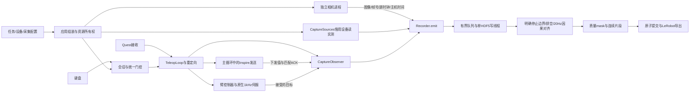

# 架构与依赖边界

应用层组装三个独立模块；不使用事件总线、插件框架或额外队列。运行时沿用直接回调、相机进程管道和单写盘队列。

```text
DexRetarget/
├── config/                   # robots/tasks/cameras/collection/retargeting/models/tools
├── dexretarget/
│   ├── app/                  # 唯一应用组装层
│   ├── teleop/               # 控制与跟踪保持
│   ├── camera/               # 独立相机进程
│   ├── dataset/              # 纯记录/存储/对齐/导出
│   ├── policy/               # OpenPI 表示适配
│   └── config.py / contracts.py / lifecycle.py
├── data/                     # 数据与说明，无 Python 采集实现
├── anydexretarget/           # 重定向算法库
├── rokae/                    # 原生驱动、控制器和调试入口
├── tools/                    # 诊断/仿真/维护
├── integrations/             # 其他设备与标定 GUI，正式入口不依赖
├── assets/ / kuka_iwaa/       # 模型资源与双 IIWA 后端
└── docs/ / archive/           # 当前文档与历史资料
```

## 依赖规则

| 模块 | 允许依赖 | 不允许承担 |
| --- | --- | --- |
| `teleop` | 数学/重定向、驱动、ROKAE 控制器、结构化观察接口 | 相机初始化、数据集/文件写入、录制生命周期 |
| `camera` | 纯配置、SDK、编码和进程通信 | 机器人控制、Recorder/HDF5、任务状态 |
| `dexretarget.dataset.recorder` 及存储/对齐 | 纯配置、通用几何、数值/文件库 | 相机/机器人初始化、反馈线程、运动下发 |
| `app` | 上述三者 | 重写 1 kHz 伺服、存储格式或设备协议 |

旧 `dexretarget.dataset.runtime.Collector`、`dexretarget.dataset.cameras`、`anydexretarget.teleop.session`
和旧脚本是兼容适配层；新应用不依赖它们。兼容层的组合依赖不代表核心层的依赖方向。
数据 CLI 与模拟 CLI 同样放在应用层；`python -m dexretarget.dataset` 只转发命令。
公共几何从 `anydexretarget.geometry` 读取，旧 `teleop.pose` 路径继续导出同一函数。

## 实际控制流与数据流



遥操作不指挥相机。`--no-capture` 不创建采集源或 writer；采集模式下源先运行，r 只接入
writer。相机进程拿到父进程配置快照，不重读 collection 文件。不存在同一设备的第二个控制实例。
反馈线程借用原来的臂/手实例；串口读写继续共享驱动锁。

控制观察接口只报告 tracking、接受的臂目标、手下发确认和 control 事件。schema 转换在
CaptureObserver，读取频率/时间窗在 CaptureSources，记录与文件格式在 Recorder/writer。
观察值、请求值、控制器接受值和实际反馈仍分开保存；没有将实测值替换为动作。

## 并发与生命周期

- Session 门控锁覆盖最终臂发布和手发送；retarget 计算在锁外；qpos 与接收时间在状态锁内原子更新。
- 相机每角色一个进程、一个读管道线程；图像编码不进入 1 kHz 回调。
- Recorder 仅短时间持有入口锁；排空/对齐使用后台任务，应用不再从控制线程写 HDF5。
- writer 摘下后仍由 Recorder 跟踪，直到线程关闭；启动失败/退出也清理待完成 writer。
- 始终先暂停跟随、等待独占 home/保存工作，再关闭输入/数据/采样源，最后断开串口和机器人。
- source 读取退出后才允许断开借用的设备，避免句柄释放后的 SDK 调用。原生 SDK 的阻塞/停止时延仍需真机验证。
- `.partial-*` 只有完成排空、关闭、对齐、元数据写入后才原子提交；异常段不冒充完整训练数据。

时间戳、单位、20 Hz 网格、12 维表示、32 维模型接口和原始 HDF5 schema 沿用现有约定。
详细字段见[数据模块](../data/README.md)，兼容性/故障注入与性能证据见[验证报告](refactor_report.md)。

## 跟踪保持

Session.enabled 表示操作者意图，Session.tracking_held 表示当前输入不可用于控制。二者分开；臂目标发布与手发送检查两道门。HOLD 时臂调用驱动 hold、手停止新增目标，记录 control=false；恢复连续新鲜后，在会话锁内重建参考、重置 IK，再允许发送。手目标从最后发送值渐变，记录的是实际下发并确认的寄存器值。手动暂停不会被恢复覆盖。实时故障处理保持独立。
