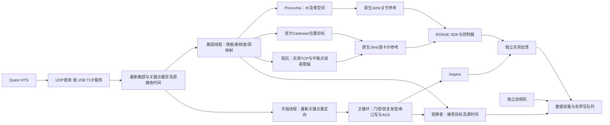

# 遥操作跟随、逆解与延迟审查

2026-10-30；适用 Quest HTS → ROKAE xMatePro3 / Inspire，SDK 0.3.4。此次只做离线、原生计算核心与模拟设备验证，没有连接、上电或运动真机。现有相对位置、工具相对姿态、倍率和工具 Z 轴拧转映射保持不变。

## 六个问题的结论与实际修改

| 问题 | 发现与处理 | 验证边界 |
| --- | --- | --- |
| Pinocchio IK / 零空间 | 保留当前主任务 DLS、SVD 几何零空间、使能姿态参考和统一边界。合并误差/Jacobian 的模型遍历；复用 SVD 求 DLS，去掉重复 FK 和稠密求解 | 数值等价测试、±90°工具纵轴回归通过；不声称全局最优、避障或任意目标可达 |
| 官方补偿是否更好 | 区分运动学标定、动力学补偿与参考生成。主机关节目标也进入 ROKAE 自身伺服；不是用了 Pinocchio 就失去控制器全部补偿 | 旧控制器内部补偿实现未公开验证；没有真实精度对比，不能判定官方笛卡尔必然更准 |
| 链路时延 | 原先手指优化串行阻塞腕部；串口 ACK 等待占用共享使能锁。现将手优化独立、只取最新帧；串口只有实际写包持有门控锁，回包在锁外等；完整 ACK 到达后结束读取 | Python 线程仍受 GIL/CPU 调度影响；串口读写仍互斥，无并发乱序写包 |
| 视觉跟手与预测 | 增加可选分段计时，保留原始接收时间和过期门控。未增加机器人侧预测 | HTS 遮挡产生的新鲜但错误关键点不能靠时延修复；当前协议缺少逐指可靠置信度 |
| 平滑与跟手 | 已有 1 kHz 原生参考生成与 SDK 滤波，并非“完全没有插值”。旧参考增益绑定 a/v，单纯调大速度反而可能变慢。增加可独立配置的三阶参考响应，保留现有限速/加速度/jerk | 所列阶跃与反向模拟改善，不代表真实电机响应或全状态稳定性证明 |
| 两条底层路线协同 | 输入、手重定向、门控、串口和计时共用；关节参考与笛卡尔/阻抗参考均支持新响应参数。阻抗继续以移动平衡点为输入，保持误差限幅 | 独立固定平衡点阻抗测试不使用移动参考生成器；其负载、刚度和退出阈值未在此轮调节 |

## 实际控制与数据流



手部求解中不持有臂手使能锁。输出 qpos 与对应源时间成对发布；串口拿到所有权后重新检查使能/过期，防止排队期间暂停却继续发旧目标。手指求解超时仍会使跟随进入 HOLD，不为了降低延迟复用无限老的数据。停止时先关闭门控再结束线程和设备。

采集仍保存后端接受的参考与独立实测状态：接受参考不等于电机实际到位。原始 HDF5、对齐规则、时间戳含义与 12 维有效动作未更改。阻抗目标仍是限幅后的平衡位姿，不能用实测受力偏移替代策略动作。

## Pinocchio、官方运动学与补偿

Pinocchio 本身支持运动学和动力学；本项目只用其运动学模型、FK、Jacobian 和主机微分 IK，没有自行实现 ROKAE 专有摩擦、弹性或力矩传感器标定补偿。官方模型接口提供 FK/IK，完整动力学模型接口还涉及重力、摩擦、科氏与惯性计算；这些计算接口存在，不等于当前 `nomodel` 二进制开放全部能力，也不等于更换 IK 就开启另一套补偿。[ROKAE 官方 model.h](https://github.com/RokaeRobot/xCoreSDK-CPP/blob/main/include/rokae/model.h)

主机 IK → `jointPosition` 与官方 Cartesian → 控制器 IK 的区别，首先是**谁把 TCP 目标转成关节参考**。两者都经过控制器伺服。运动学模型/零位补偿影响几何精度，负载/重力/摩擦补偿影响跟踪与受力行为，参考滤波影响动态滞后，不能混成一个“补偿算法”。新版文档公开的 DH/零位补偿接口不能证明控制器 2.3.2 具备同样配置；本次未替换 SDK、固件或写入这些参数。[官方新版 API](https://docs.rokae.com/docs/SDK--0-7-x-AR/cpp/cpp_API/)

本项目 IK 是局部 resolved-rate DLS，零空间副任务只保证当前 Jacobian 的一阶性质。此次 SVD 复用在相同误差/Jacobian 下与原公式数值等价，没有改为另一种 IK 目标或调换手腕轴。官方 IK 示例也不代表全局最优；Pink 的任务约束 QP 是今后加入更复杂约束的一种方案，但需评估局部极小、耗时与模型一致性，当前没有引入新依赖。[Pinocchio IK 示例](https://github.com/stack-of-tasks/pinocchio/blob/devel/examples/inverse-kinematics.cpp)、[零空间教程](https://gepetto.github.io/doc/pinocchio/doxygen-html/md_doc_d-practical-exercises_3-invkine.html)、[Pink](https://github.com/pink-kinematics/pink)

评估精度需同时记录目标、原生参考、实测关节/TCP，并用独立测量检查物理位置。控制器 FK 自报的 TCP 不能单独证明真实几何精度。阻抗允许受力偏离平衡点，通常不应以接触时零位置误差作为目标。

## 响应参数与限制的唯一归属

| 配置位置 | 作用 |
| --- | --- |
| `config/robots/rokae.yaml: teleoperation` | 原位置/姿态映射、使能恢复；本轮未改 |
| `config/models/xmate_er_pro_7.yaml: stream.response_hz` | Pinocchio 路线的原生关节参考响应，目前 2 Hz |
| `config/robots/rokae.yaml: safety.response_hz` | 官方笛卡尔位置和阻抗共用参考响应，目前 2 Hz |
| `config/robots/rokae.yaml: control.impedance` | 阻抗刚度、平衡点误差限幅及该模式覆盖项 |
| `config/quest/*.yaml` | `--config` 选择传输方式；不是控制器增益配置 |

两个 `response_hz` 分别属于不同执行空间，不在任务配置重复定义；`--arm-control pinocchio/cartesian/impedance` 选择后端。`response_hz` **不是视觉频率、实际阻抗阻尼或固件力矩带宽**。

`response_hz=0` 保留旧递推，可在相应唯一配置处回退。正值使用三阶参考跟踪，令误差 e、当前参考速度 v、加速度 a，未饱和时：

```text
j = w³ e - 3 w² v - 3 w a
a_next = limit(a + limit(j, j_max) dt, a_max)
v_next = limit(v + a_next dt, v_max)
```

w 不超过 `2π response_hz`，并随误差/速度/加速度及 jerk 预算减小。关节逐轴处理；笛卡尔平移与旋转向量分别按范数处理，旋转仍使用 SO(3)。保留前级低通、死区、新鲜度、目标跳变检查和关节边界；没有放宽速度、加速度、力矩或固件保护。

尝试只提高旧二阶增益时，离线试验出现 jerk 饱和导致的过冲和振荡，因此未采用该方案。新方法加入加速度反馈，并验证反向与较大目标；这不是全域稳定性证明。硬位置边界的最终裁切优先于平滑，不能据此承诺所有边界状态都保持 jerk 连续。当前 2 Hz 仍需要真机小幅验证后评价手感，不能按允许输入范围把 5 Hz 当成已验收的硬件参数。

ROKAE SDK 自带滤波仍保留当前配置，额外叠加滤波可能增加滞后。Franka 官方也区分滤波、限速、运动生成和内部补偿；不能复制其刚度/滤波数字当作 ROKAE 参数。[ROKAE RT 接口](https://github.com/RokaeRobot/xCoreSDK-CPP/blob/main/include/rokae/motion_control_rt.h)、[libfranka 说明](https://frankarobotics.github.io/docs/doc/libfranka/docs/overview.html)

## 延迟测量与离线结果

添加 `--timing-report /tmp/teleop.json`：内存中每个指标最多保存最近 4096 个样本，退出并清理设备后写一次 JSON。`count` 是总样本数，分位数针对保留窗口，单位 ms。统计包含腕部接收→目标接受、门控等待、映射、IK、阻抗读取/限幅、手优化、串口事务、关键点接收→写手目标。计时关闭时不收集样本，不逐帧写盘。

**此计时起点是主机收到 HTS 数据，不包括头显曝光、内部推理、到主机之前的 USB/Wi-Fi、真实伺服与机械响应。** 手指完成帧时间不能冒充新接收时间。分段分位数有重叠，不能将各 p95 相加当作端到端 p95。

本机离线基准（50 Hz 参考、1 kHz 原生计算核心；未连接机器人）：

| 测试 | 旧参考 response=0：到半目标 | 新参考 response=2：到半目标 | 新参考此次阶跃结果 |
| --- | --- | --- | --- |
| 关节 J1 0.1 rad | 328 ms | 290 ms | 无过冲；末段残差约 0.000133 rad |
| Cartesian 平移 10 mm | 445 ms | 356 ms | 无过冲；约 0.978 mm 死区残差 |
| Impedance 平衡点平移 10 mm | 405 ms | 356 ms | 无过冲；约 0.978 mm 死区残差 |

这是**参考轨迹响应**，不是通信延迟，也未包含 SDK 滤波和真实动力学。独立暖机 IK 1000 次：p50 0.057 ms、p95 0.076 ms、p99 0.140 ms；调度/GIL 竞争时明显增加，不能当作实时上界。

模拟 Quest UDP、Inspire PTY、mock arm、合成双相机的整链测试（三路线同时跑，存在 CPU 竞争）：

| 路线 | 腕部接收→目标接受 p50/p95 | 手指优化 p50/p95 | 关键点接收→手串口写 p50/p95 |
| --- | --- | --- | --- |
| Pinocchio | 2.83 / 5.99 ms | 17.91 / 26.49 ms | 33.60 / 54.56 ms |
| Cartesian | 2.35 / 7.52 ms | 20.11 / 31.50 ms | 39.09 / 68.09 ms |
| Impedance | 2.78 / 8.61 ms | 21.12 / 35.18 ms | 42.04 / 72.79 ms |

该数据支持“拆开手优化与腕部处理”，不支持认定真实 Quest 通信仅 2–3 ms。单进程模拟 TCP/Unix relay 的接收→探针 p50 为 0.429 ms，直收探针对照 0.263 ms；包含探针轮询，亦不是 USB 或跨进程真机时延。

借鉴 Open Teach 的独立臂手频率/异步处理；其论文也承认视觉遮挡和指姿误差。当前先消除阻塞和参考滞后，不通过外推掩盖遮挡。预测可作为后续有界实验，但在反向、接触和失跟踪时可能放大错误，不默认启用，更不能伪造新鲜时间。[Open Teach §IV、§VI](https://arxiv.org/html/2403.07870)

## 复现与现场下一步

```bash
conda activate dexteleop
bash rokae/build.sh
# 只运行主机和原生计算核心，不连接任何机器人
LD_LIBRARY_PATH="$CONDA_PREFIX/lib${LD_LIBRARY_PATH:+:$LD_LIBRARY_PATH}" \
  python tools/diagnostics/benchmark_teleop.py --output /tmp/teleop-benchmark.json

# 真实遥操作：启动流程仍会按任务配置回 home
python -m dexretarget --config config/quest/udp.yaml \
  --task-config config/tasks/cup.yaml --arm-control pinocchio --no-capture \
  --timing-report /tmp/teleop-pinocchio.json
```

USB 替换通信配置并保持 Quest 服务；阻抗替换 `--arm-control impedance`，使用前完成独立阻抗静态测试。其他目标、负载和刚度不要同时修改。先比较小幅相同运动的时延报告，再分别检查真实 TCP/关节跟踪误差与接触偏移。遮挡时看新鲜度和手姿错误，不将其与 IK 延迟混淆。若要量完整视觉→动作时延，需要同步头显源时间或高速视频，当前主机统计不能补出缺失时间段。

## Review 与验证

- 完整 pytest：**416 passed，9 subtests passed**，无 skipped；包含原映射及工具 Z 轴 ±90°、IK 数值等价、暂停/恢复、数据契约、串口门控并发与源时间检查。
- 原生桥接在 dexteleop 重新构建成功，仍链接本地 SDK 0.3.4。Python/C++ 新旧参考模式逐点一致；反向、hold、平移/旋转速度与加速度/jerk、较大关节目标的实际输出差分测试通过。
- 三路线完整模拟录制均通过：第一段 140 帧，因故意插入暂停/丢帧分别有效 118/120/120；第二段各 24/24 有效，无缺失流。未将故意无效帧当作有效数据。
- 无采集模拟遥操作另外通过：196 次手写命令，启动暂停/使能/暂停/home/退出正常。项目静态检查通过：209 个 Python 文件、47 个规范模块、224 个本地 Markdown 引用无错误；`git diff --check` 通过。两种后端的只读配置解析通过，映射源文件与 `teleoperation` 配置和 HEAD 一致。
- Review 修复：ACK 等待期间不占门控；取串口后重查暂停和数据过期；可选报告写盘失败不覆盖原始控制异常；删去不再使用的等待串口静默实现。
- 未覆盖：真实 Quest 视觉/无线/USB、真实手串口反馈速度、硬实时调度、机器人模型标定精度、真实接触阻抗和策略部署性能。模拟通过不代表这些已验收。
