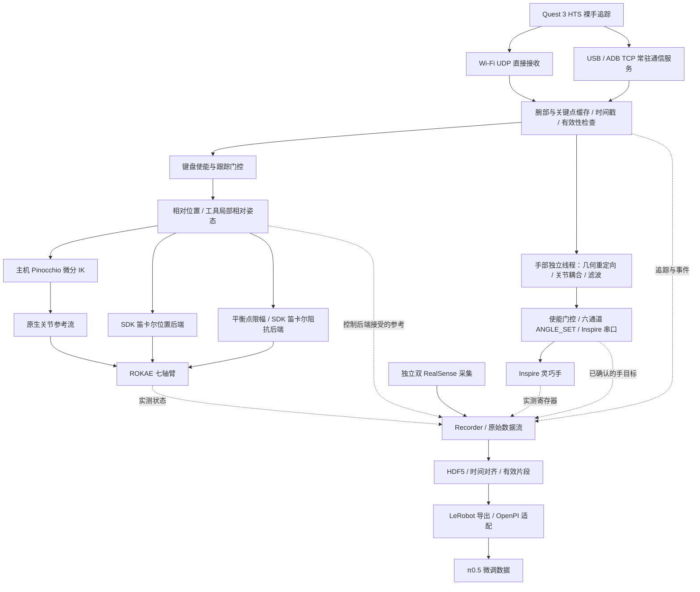

# 遥操作范式对比与本项目取舍

调研日期：2026-10-30。目标：Quest 3 → ROKAE 七轴臂 + Inspire RH56DFX，采集 π0.5 示范并保持部署时的柔顺交互。优先采用论文原文、作者代码和厂家资料；公司 demo 没公开的参数不凭视频推断。

## 先分清四层概念

- **位姿映射**：绝对映射将经过坐标变换的主端位姿作为目标；相对映射由使能/离合时的主从参考位姿计算目标。位置和姿态可以采用不同规则。
- **速度/增量接口**：发送末端速度、逐帧位姿增量，或关节速度；与“相对初始参考的位姿目标”不是同一件事。微分 IK 的输出含关节增量，也不能据此把上层映射叫作速度映射。
- **retargeting / IK**：手指形态转换与机械臂逆解是两个问题；手指向量优化不决定机械臂相对/绝对映射。
- **底层控制**：同一个位姿目标可以由位置伺服执行，也可以作为阻抗平衡点执行。上层发送关节位置目标不代表底层一定是刚性位置控制；触觉残差优化也不自动等于厂家原生阻抗。

下表“未公开/未确认”代表已读材料未给出足够证据，不代表该系统没有此能力。频率列区分追踪、主机目标和底层控制，不能互相代替。

## 范式对照表

| 工作与证据 | 主动端 → 从动端 | 机械臂位置映射 | 姿态映射与离合 | 速度 / 增量还是位姿 | 手指 retargeting | IK、冗余与底层控制 | 参数与频率；本项目借鉴 |
| --- | --- | --- | --- | --- | --- | --- | --- |
| **Sharpa Vision Teleop**；厂家开源 SDK [S1] | Webcam / Meta Quest 裸手视觉 → Sharpa Wave 22-DoF；公开示例主要是手 | **机械臂未公开**，不能由手部 demo 推断 | 手指在腕部局部系处理；机械臂腕姿态/离合未公开 | 每帧手部构型 → 关节位置目标，不是机械臂速度接口 | `dex-retargeting` vector；掌宽和各手指链长校准后缩放；YAML `scaling_factor=1` 防止重复缩放 | 示例调用 `set_joint_position`；机械臂 IK、位置/阻抗与零空间均未确认 | 右手 YAML `low_pass_alpha=0.8`；实际频率取决于追踪/运行设备。借鉴：分开处理尺寸校准、轴向和滤波，不能照搬机械臂参数 |
| **Sharpa AE01 / MANUS demo**；厂家产品与演示 [S2] | 22 编码器外骨骼手套 / MANUS 数据手套 → Wave；MANUS 案例是在 Isaac Lab 仿真 | 公开案例不足以判断臂部位置规则或额外 tracker 配置 | 手指构型直接映射；腕部全局定位和机械臂姿态规则未公开 | 手套关节构型目标；不能推定为臂速度映射 | AE01 同构 22-DoF；MANUS demo 映射到 Wave 关节位置 | 手套触觉反馈、仿真手关节目标与真实机械臂阻抗是不同层；后者未公开 | AE01 厂商规格：USB 500 Hz / 无线 150 Hz；是手套输出频率，不是机械臂控制频率。借鉴：手套能缓解视觉遮挡，但不是改 IK 即可替代的能力 |
| **DexTeleop-0**；2026 预印本，Sharpa 公司解读 [S3] | Quest 3 裸手、26 关键点 → 双 UR7e + 双 Wave | 腕部 SE(3) → 臂 IK；论文未完整公开主从原点、尺度及绝对/离合相对公式 | 同上，不能仅凭“global wrist”判为绝对主从映射 | 原始关节位姿 + 力觉残差 Δq；Δq 是优化修正，不是人手速度控制 | DexPilot 风格关键点向量匹配、平滑项、关节边界 | 触觉接触力与力矩平衡 box-QP，附带关节位置/步长限制；不据此认定 UR7e 使用了厂家笛卡尔阻抗模式 | 论文没有给出足够底层伺服配置。借鉴：柔顺需要真实接触反馈；本项目未接入 KWR75B 闭环，不能声称有该触觉残差能力 |
| **DexPilot**；ICRA 2020 [S4] | 四 RGB-D 相机裸手追踪 → KUKA LBR iiwa + Allegro | 初始人手/机器人姿态建立摄像机到机器人变换，腕/掌位姿驱动末端目标；不是手柄摇杆速度 | 由视觉手掌姿态变换到机器人；原文未细分 body/spatial 增量乘法与离合实现 | 笛卡尔位姿吸引目标 → RMP 加速度场 → 关节轨迹；不是直接复制人体关节角 | 指间向量/接触相关非线性优化 | RMP 含碰撞平面，轨迹交给**力矩级阻抗控制器**；手为力矩级关节控制 | 臂轨迹 200 Hz、手目标 30 Hz。借鉴：运动生成、避障与阻抗分层，而非靠放宽保护实现接触 |
| **AnyTeleop**；RSS 2023 [S5] | 单/多 RGB 或 RGB-D 相机 → 多种机械臂、Allegro / Shadow 等手，实机与仿真 | 多视角融合偏重**相邻帧相对运动**，避免 RGB 绝对位置不准；目标落到笛卡尔位姿 | 多相机先对齐旋转；所读原文未给出通用腕姿态 body/spatial 公式 | 位姿目标 → CuRobo 关节轨迹；不是因为轨迹有速度就称为速度 retarget | 关键点向量匹配、尺寸系数 α、时序正则 β、关节边界 | CuRobo 生成满足限位的无碰撞轨迹，供仿真/实机**阻抗控制器**执行；不是单次局部 IK | 视觉目标 25 Hz、轨迹 120 Hz；多视角初始化 N=50。借鉴：模型准确、规划边界和感知置信度，比统一放宽限制更重要 |
| **Open Teach / Franka 路线**；CoRL 2024，作者代码 [S6] | Quest 3 裸手关键点 → Franka + Allegro；也支持 xArm/Jaco/Stretch | 初始化/恢复记录主从参考；代码使用 `H_robot_ref @ H_mount @ inv(H_hand_ref) @ H_hand_now @ inv(H_mount)` | **相对参考** SE(3) 映射；固定工具安装变换；暂停恢复重建参考 | 映射层输出 7D 位姿；Franka 包装层再把目标/实测位姿误差缩放、限幅，作为 OSC action；不是直接发送绝对 TCP 给固件 | Allegro 按手指几何/IK，拇指有专门规则 | 公开 Franka 包装器指定 Deoxys `OSC_POSE`：力矩级操作空间阻抗，含姿态副任务；不同机器人后端不同。Allegro 是 PD 力矩 + 重力补偿 | 代码精细模式平移倍率 0.6，普通 1；论文 Franka 目标 60 Hz、Allegro 底层 300 Hz。借鉴：离合重定参考和固定安装变换，接近本项目工具相对姿态思路 |
| **Open-TeleVision**；CoRL 2024 [S7] | Apple Vision Pro 裸手/头部 → H1 七轴双臂 + Inspire / GR-1 + 夹爪 | **腕相对头部的位置**，经固定轴变换；不是相对使能初始手位置 | **绝对腕姿态**，相对于 VR 初始化世界；代码仅减头部平移，避免头转动改变手姿态 | SE(3) 位姿目标 → CLIK → 关节位置目标 | 手部局部关键点重定向；不同末端不同配置 | Pinocchio CLIK、SE(3) 滤波、零空间关节修正；论文输出关节位置目标，不能无证据标作厂家原生笛卡尔阻抗 | 系统环路约 60 Hz。借鉴：位置/姿态可混合；其头部参考不适合未经验证直接替换本项目现有映射 |
| **DROID**；RSS 2024，官方采集代码 [S8] | Oculus/Quest **手柄** + trigger 离合 → Franka Panda + 平行夹爪 | 记录 VR/机器人原点，比较双方位移，得到相对目标误差 | 对双方相对四元数再计算误差；离合重置原点 | 官方 `oculus_controller` 输出限幅的归一化笛卡尔速度 action；下游转关节速度/位置；另有目标位姿元数据 | 夹爪开合，不含五指 retargeting | 官方 Franka 路径启动 Polymetis Cartesian impedance，更新关节目标；不等于直接调用 ROKAE 笛卡尔阻抗 | 代码有 position/rotation action gain 和速度限幅；是反馈速度命令，不是手柄位置直接等于关节位置。借鉴：记录目标、命令与实测，离合与录制分开 |
| **GELLO**；CoRL 2023，作者软件与 FR3 demo [S9] | 同构缩小型编码器主臂 → UR / xArm / Franka，从动夹爪 | **关节空间映射**，TCP 由 FK 产生；无独立 TCP 相对/绝对选项 | 腕关节随同构主臂，避免单独求腕姿态 IK | 绝对关节角经过零偏/符号校准发送；不是笛卡尔速度 retarget | 主端夹爪关节映射到平行夹爪 | 无需通用臂 IK；各机器人 API 后端不同。仓库 FR3 ROS2 示例明确是**关节阻抗**，不能推定所有 UR/xArm 也如此 | FR3 demo 的 K/D、超时与关节状态校验单独配置。借鉴：零空间意图由主臂直接表达，裸手六维腕追踪没有这个额外通道 |
| **UMI**；RSS 2024 [S10] | GoPro+手持夹爪采人类操作 → 训练后部署 UR5e / Franka | 采集时**没有实时从动机械臂**；SLAM 恢复轨迹，策略使用相对轨迹表示 | 相对轨迹表示不等于 VR 离合映射；不能拿它证明裸手绝对姿态更好 | 不是在线主从速度控制；采集、动作表示、部署跟踪分开 | 平行夹爪宽度，不含五指重定向 | 控制器因部署机器人而异；所引材料不支持统一标为一种阻抗 | 重点是推理时观测/动作延迟匹配和运动可行性验证；适合借鉴数据/部署时间语义 |
| **Isaac Lab SE(3) teleop / Diff-IK demo**；官方代码 [S11] | 键盘/SpaceMouse/OpenXR 等设备 → 所选仿真臂/手 | `DifferentialIKController` 可配置 absolute / relative command；设备配置不同规则不同 | 四元数姿态目标或轴角增量，坐标系需匹配 task；不是统一世界绝对姿态 | 相对 pose 增量或绝对 pose → 微分 IK → 关节位置目标 | 单独依赖所选手部 retargeter | pinv / SVD / transpose / DLS 方法；Articulation actuator 与动作配置决定执行，不自动等于真实机器人原生阻抗 | 借鉴：清楚声明 action 类型、坐标系与执行器；不要只看到 “Diff-IK” 就判断速度映射 |
| **本项目当前路线**；本地可审查代码 [L1] | Quest 3 HTS 裸手，Wi-Fi UDP / USB TCP → ROKAE 七轴 + Inspire | 相对使能参考的位移，`translation_scale` 与固定轴变换 | `tool_relative`：`R_goal=R_ref A (R_hand_refᵀ R_hand_now) Aᵀ`；e/c/恢复重建参考 | 上层是相对参考的**位姿目标**；Pinocchio 后端用微分 IK 得关节目标 | 本项目手部重定向 → Inspire 六寄存器目标 | 默认主机 IK + ROKAE jointPosition；Cartesian 后端由控制器解算；impedance 后端目标是平衡位姿；三条路线不可混称 | 1 kHz 是原生执行回调，不是 Quest 或 Python IK 频率。本轮保留已经好用的工具纵轴滚转映射，仅改模型验证、限位一致性和 IK 冗余策略 |

## 本项目的完整技术路线

以下描述对应当前仓库代码与默认配置，而不是待实现的理想方案。**本项目采用 Quest 3 裸手视觉追踪，以离合参考下的相对位置和工具局部相对姿态控制机械臂，以几何优化重定向手指，同时独立记录双相机和机器人反馈，生成用于 π0.5 微调的数据。** 默认机械臂执行路线是 **Pinocchio 主机微分 IK → 关节位置目标 → ROKAE 实时关节位置控制**；可切换控制器笛卡尔位置或原生笛卡尔阻抗后端。

### 1. 主从设备与模块职责

| 层次 | 本项目实际方案 | 职责与边界 |
| --- | --- | --- |
| 主动端 | Quest 3 的 Hand Tracking Streaming（HTS）裸手视觉追踪 | 提供腕部位姿和手部关键点；当前路线不需要手柄、数据手套或额外 tracker |
| 从动端机械臂 | ROKAE ER3Pro 七轴臂，当前 SDK 识别为 `xMatePro3` | 执行关节目标、笛卡尔目标或阻抗平衡目标；当前控制器为 2.3.2，桥接使用官方 C++ SDK 0.3.4 |
| 从动端手 | Inspire RH56DFX | 六个独立控制通道；手模型中的耦合关节不是额外独立执行器 |
| 场景观测 | 腕部 D435i + 全局 D455 | 给数据集和后续策略提供 RGB 观测；不参与 Quest 手部识别，也不是当前遥操作视觉伺服反馈 |
| 外置力传感器 | 末端安装的 KWR75B | 当前未接入遥操作力反馈闭环；不能把物理安装等同于已有接触力残差控制 |
| 应用装配 | `dexretarget/app/` | 加载配置、管理生命周期、统一键盘门控和连接控制/记录接口 |
| 遥操作 | `dexretarget/teleop/`、`anydexretarget/`、`rokae/control/` | 接收追踪、位姿映射、手指重定向、IK 和运动执行；不负责 HDF5 存储 |
| 相机 | `dexretarget/camera/` | 独立采图，提供图像和时间信息；不控制机器人 |
| 数据 | `dexretarget/dataset/` | 观察命令与反馈、对齐、质检、保存、回收与导出；不拥有另一套机器人控制连接 |
| 策略适配 | `dexretarget/policy/` | 统一 OpenPI 的训练输入、动作输出和本项目数据表示；不代表真机策略部署已验收 |

### 2. 实际控制流与数据流



图中的三条机械臂路线是**择一执行**，不会同时向机械臂发送三套命令。相机、状态读取和写盘不进入原生 1 ms 控制回调；手与机械臂共用使能意图，但不同硬件的命令不是原子同时到达。手指优化与腕部处理分别运行，只取最新输入，串口等待 ACK 不持有臂手使能锁。应用通过观察接口将控制事件交给数据模块，反馈读取复用已打开的设备，避免重复初始化。

当前关节参考与笛卡尔/阻抗参考均采用可配置的三阶参考跟踪（`response_hz=2`，设为 0 回退旧递推），保留原来的速度/加速度/jerk 限制和 SDK 滤波；未增加视觉预测。它是目标轨迹平滑，不是物理阻抗阻尼。时延、官方补偿与主机 IK 的区别、模拟对比和现场测量方法见[跟随与延迟审查](docs/teleop_latency_review.md)。

### 3. 两种通信路线，映射算法相同

| 路线 | 连接与启动方式 | 时序处理 |
| --- | --- | --- |
| 无线 UDP | 主机和 Quest 位于互通局域网；HTS 发送到主机 Wi-Fi IPv4 的 9000 端口；遥操作单进程直接接收，不需要通信服务或 ADB | 使用最新追踪缓存和接收时间判定新鲜度；不等待重传旧动作 |
| 有线 USB TCP | USB 授权后，通过 ADB reverse 转发 8000 端口；`python -m dexretarget.quest --config config/quest/usb_tcp.yaml` 持有 HTS 连接，遥操作通过本机 Unix socket 订阅 | 通信服务可持续运行，遥操作可独立启停；慢订阅者不阻塞头显接收，保留原始主机接收时间，不在 1 kHz 回调中等待 IPC |

通过 [`config/quest/udp.yaml`](config/quest/udp.yaml)、[`config/quest/usb_tcp.yaml`](config/quest/usb_tcp.yaml) 和 CLI `--config` 选择路线；当前 Cup 任务默认引用有线配置。切换传输不会改变坐标约定、手指通道或数据动作定义。完整启动步骤见[操作手册](README_QUEST3_INSPIRE_ROKAE.md)。

HTS 输入为腕部 `xyz + quaternion_xyzw` 与 `21×3` 手部关键点。接收层统一完成 Unity 左手系到项目右手系的转换：项目轴约定为 X 前、Y 左、Z 上；腕部旋转和关键点必须使用同一转换。腕部与关键点分别维护接收时间，不能用某一种消息持续到达证明另一种消息仍有效。实现见 [Quest 接收器](dexretarget/teleop/devices/quest3.py)。

### 4. 机械臂位置与姿态：相对参考，不是速度摇杆

设使能/重新定参考时的人手腕部为 `(p_H0, R_H0)`，机器人参考 TCP 为 `(p_B0, R_B0)`。`B` 为机器人基座，`W` 为项目世界，`Q` 为人手位置增量到世界的固定轴变换，`A` 为腕部局部轴到工具局部轴的操作约定。

**位置采用相对参考的空间位移：**

```text
p_W_goal = p_W0 + translation_scale · Q · (p_H_now - p_H0)
p_B_goal = T_base_world · p_W_goal       # 对位置使用齐次坐标变换
```

当前基座与世界配置重合，`Q=I`，`translation_scale=1.0`。它比较当前手与参考手的位置，不积分相邻帧速度；手腕旋转也不会把位置控制轴一起旋转。修改安装变换时，必须同时维护世界与基座的约定，不能默认所有机械臂都与世界重合。

**姿态采用初始腕部局部相对旋转，映射至初始工具局部轴：**

```text
ΔR_H = R_H0ᵀ · R_H_now
R_B_goal = R_B0 · A · ΔR_H · Aᵀ        # rotation_scale = 1 时

A = [ 0  0 -1
      0  1  0
      1  0  0 ]
```

当前 `rotation_mapping: tool_relative`、`rotation_scale: 1.0`。`A` 规定腕局部 X → 工具 Z、Y → 工具 Y、Z → 工具 −X，因此纵轴拧腕对应工具 Z 拧转。缩放旋转时使用 SO(3) 旋转向量再指数映射，不是分别相加欧拉角；无需依靠切换欧拉角顺序实现 90° 滚转。这个矩阵是现有操作轴约定，不是根据安装照片完成的工具标定。

按 `e` 使能、`c` 重定参考或跟踪恢复时，系统用新鲜腕部与当前命令 TCP 重新建立参考，同时重置主机 IK 参考。**相对参考**不等于每帧累加，也不等于直接复制 VR 世界中的绝对姿态；home 则是单独的任务准备姿态。TCP 是控制器当前工具控制点，不会自动变成手掌/指尖；负载质心也不是 TCP。算法见 [RelativePoseMapper](anydexretarget/teleop/arm.py)，有效参数见 [robot YAML](config/robots/rokae.yaml)。

### 5. 手指：几何优化重定向到六个执行通道

默认使用 [`AdaptiveOptimizerAnalytical`](anydexretarget/optimizer/analytical_optimizer.py)，配置为 [Quest/Inspire adaptive YAML](config/retargeting/adaptive/quest3/quest3_inspire_hand.yaml)。流程是：关键点预处理与手局部系转换 → 按人手/机器人手几何尺度匹配 → 优化手指向量、指尖位置/方向和捏合约束 → 展开耦合关节 → 低通滤波 → 转换 Inspire 寄存器目标。

优化包含 Huber 损失、时间正则和自适应捏合权重，并使用解析梯度。当前尺度系数为 `1.16`，低通 `lp_alpha=0.4`；后者是无量纲系数，不是 0.4 Hz。仓库还提供 `--optimizer vector` 的关键向量路线，但它不是当前默认值，也不应与 Sharpa 的具体实现混称为同一个配置。

输出通道顺序固定为 **`little, ring, middle, index, thumb_bend, thumb_rotation`**，发送 `ANGLE_SET` 的 `0..1000` 目标。它是关节构型重定向，不是手指速度控制；实际手反馈由 `ANGLE_ACT` 单独读取。寄存器换算和方向处理在 [Inspire 适配层](dexretarget/teleop/devices/inspire.py)，数据导出不再额外反转一次。

**当前遮挡边界：**HTS 接口没有逐指可见性/置信度。新鲜、有限但识别错误的无名指/小拇指关键点仍可能导致握紧；全手超时 HOLD 和低通只处理断流/抖动，不能证明已解决遮挡。当前没有逐指遮挡重建，也没有接触感知自动修正。

### 6. 三种机械臂后端：目标一致，逆解与执行不同

| 后端 | 上层目标与 IK | 底层执行 | 零空间与柔顺含义 |
| --- | --- | --- | --- |
| `pinocchio`，当前默认 | 相同 TCP 位姿目标 → 主机自定义微分 IK → 七关节目标 | 原生关节参考流滤波及速度/加速度/jerk 限制 → SDK `jointPosition` | 主机可以显式设置姿态副任务；这条路线没有启用 SDK 笛卡尔阻抗 |
| `cartesian` | 相同 TCP 目标，交由控制器完成笛卡尔逆解 | SDK `cartesianPosition` | 使用启动时测得的固定臂角 `elbow_m`，不是第七关节角；不等同于主机自由优化零空间 |
| `impedance` | 相同 TCP 目标先限制与实测 TCP 的距离，作为移动平衡点；不经过主机 Pinocchio IK | SDK `cartesianImpedance` | 接触时允许偏离平衡点；当前不强制指定臂角，也不能据此声称固件内部没有冗余策略 |

**Pinocchio 路线的实际“最优性”：**Pinocchio 提供模型、FK 和 Jacobian，求解策略由本项目实现，并不是调用一个自动全局最优 IK 黑箱。主任务用阻尼最小二乘（DLS）降低 TCP 误差；副任务使用完整 SVD 得到的几何零空间，跟随使能/重定参考时的关节姿态，并加入关节限位回避和接近奇异时的弯曲修正。默认参考是 `initial`，不会持续把臂拉回历史 neutral 姿态。

主任务先按有效位置/速度边界统一缩放，副任务再使用剩余范围，避免逐关节裁切破坏运动方向；主机模型与控制器软限位取交集并传给原生关节流。零空间只保证当前 Jacobian 下的一阶性质；DLS、混合平移/旋转单位及局部迭代仍有近似，**没有全局最优、全路径避障或任意姿态可达保证**。启动前的官方 FK 多姿态数值对照用于发现模型/坐标问题，查询虚拟关节角不代表实际移动到这些位置。实现及审查见 [IK](rokae/control/differential_ik.py)、[模型](rokae/control/model.py)、[IK 配置审查](docs/ik_config_audit.md)。

**阻抗路线的实际配置：**当前刚度为 `[300,300,300,15,15,15]`，单位分别是 N/m 和 Nm/rad；期望外力/力矩为零，力控方向系为 `tool`。平衡点相对实测 TCP 的误差上限为 40 mm / 0.30 rad，这不是宣称机械臂具有这些数值的接触安全认证。参考运动另有速度/加速度限制，和固件实际速度/力矩保护、独立测试程序退出阈值分开。

负载采用最近截图对应的质量 `0.96 kg`、质心 `[-0.05143,0.00823,0.00840] m`，保持原始轴顺序与符号；启用 `apply_on_impedance_start` 时写入 SDK Toolset 并读回，保留当前 TCP/惯量，再以活动负载同步 RT `setLoad`，不是将质量加两次。截图舍入值和 API 成功不等于独立动力学验收；零/未知惯量也没有被“质量+质心”推算为完整惯量。

SDK 0.3.4 这条笛卡尔阻抗接口没有本项目可直接调节的独立阻尼参数；YAML 中 `mock_mass/mock_damping` 仅用于仿真，**不会设置真实机械臂阻尼**。预期效果是围绕移动目标的弹簧响应，而不是自由拖动或纯重力补偿；实际回弹、负载补偿、稳定性与接触效果仍需真机验收，不能从默认位置控制或离线 mock 通过推导出来。见 [阻抗控制器](rokae/control/controllers/impedance.py)。

### 7. 使能、HOLD、恢复与录制相互独立

- `e` 统一使能/暂停臂手，`p` 暂停，`c` 重新定参考，`h` 回任务 home。默认从暂停开始；回 home 不等于开始跟随。
- 腕部/关键点无效或过期时，停止更新跟随目标。位置路线保持参考，阻抗路线保持平衡参考但仍可能受力让位，不能说真实末端一定静止。
- 短时跟踪丢失保留使能意图；连续新鲜数据窗口当前配置为 `0.01 s`，恢复时重新定参考，手指目标另有渐变。实际恢复还受输入帧率和调度影响，不承诺 10 ms 端到端延迟。手动暂停需要再次使能，真实故障不自动恢复上电。
- `r` 从当前有效状态开始记录，`s/f` 保存成功/失败，`d` 回收上一段。**不要求每段从固定 home 开始**；可以先使能调整，再按 `r`。回 home 与录制互锁，避免把回位轨迹误当任务示范。

### 8. 采样、同步、存储与 π0.5 动作契约

| 数据/执行层 | 当前配置 | 含义 |
| --- | --- | --- |
| Quest 追踪 | 按 HTS 实际到达的新帧处理 | 不是 1 kHz；无线与 USB 需分别测实际时延/抖动 |
| Inspire 命令调度 | 目标 100 Hz | 新重定向结果依赖关键点新帧；串口与系统调度影响实际频率 |
| ROKAE 原生执行回调 | 1 kHz | 消费/平滑参考，不表示 Python IK 或视觉每毫秒更新 |
| 双 RealSense | 各 640×480、30 fps、RGB，当前关闭深度 | 独立图像流，当前 JPEG 质量 95 |
| 机械臂/手反馈 | 50 Hz / 20 Hz | 实测状态，和接受的命令分别记录 |
| 对齐后的训练样本 | 20 Hz | 原始流重采样的统一时间网格，不是所有传感器必须同频 |

记录保留主机单调时间、可用的设备时间/帧号和读取时间窗口。观测取采样时刻 `t` 之前已收到的最新有效数据；动作选 `[t,t+0.05 s)` 内首个被控制后端接受的臂参考和已确认的手目标，不把未来实测位姿当作动作。当前通过软件时间对齐和年龄/跨流偏差阈值判定有效片段，**不是双相机曝光硬件同步**。阈值及数据表示只有一个采集配置源：[collection.json](config/collection/collection.json)。

原始流、对齐结果和有效性掩码保存到 `data/raw/quest_inspire_rokae/episode_*/episode.h5`，配套 `metadata.json`。单写线程与有界队列隔离写盘；结束时排空队列、对齐质检，再将 `.partial` 完成目录重命名，异常残留不能当作完整 episode。删除采用移动到 `.trash`，不提供自动永久删除。导出阶段生成 LeRobot 图像/Parquet 数据，按质量筛选片段并检查控制配置一致性。

**本项目的 state/action 都是 12 维，而不是 TCP 6+夹爪 1：**

```text
state  = [实测 TCP xyz(3), 实测 TCP rotvec(3), 实测手 ANGLE_ACT(6)/1000]
action = [接受的 TCP xyz(3), 接受的 TCP rotvec(3), 确认的手 ANGLE_SET(6)/1000]
坐标系 = robot_base；长度 m；旋转 rad；手通道顺序与第 5 节一致。
```

Pinocchio 路线的臂动作标签是 IK 之前的 TCP 参考，不是七轴关节角，也不是原生滤波后的每毫秒设定值；阻抗路线记录平衡点限幅之后的 TCP 参考。因而 **VR 用相对映射生成目标，数据集仍可记录基座系绝对 TCP 目标**，这两者不矛盾。训练和推理必须保持动作语义一致，不能把绝对旋转向量直接逐元素差分当成正确的旋转增量。

[OpenPI 适配器](dexretarget/policy/rokae_policy.py) 使用 `pi05=True, action_dim=32, action_horizon=20`，有效机器人动作仍是前 12 维；归一化与模型维度补齐由兼容 OpenPI 流程处理，输出截取前 12 维并限制手目标范围。全局/腕部图像映射到模型对应图像槽，缺失的另一腕部图像用掩码标无效。32 维是模型容量，不意味着本项目只使用 6+1，或其余通道都是物理执行器。

### 9. 配置归属与当前验证边界

| 配置 | 唯一职责 |
| --- | --- |
| [任务 cup.yaml](config/tasks/cup.yaml) | 任务说明、任务 home、通信/采集配置引用和任务级选择；home 不是 IK 姿态副任务的第二套 neutral |
| [机器人 rokae.yaml](config/robots/rokae.yaml) | 地址、安装变换、负载、位姿映射、默认后端、笛卡尔/阻抗参考参数 |
| [模型 xmate_er_pro_7.yaml](config/models/xmate_er_pro_7.yaml) | 主机运动学模型、微分 IK、关节流边界与滤波；不是重新定义 Quest 轴映射 |
| `config/retargeting/` | 手模型、关键点重定向、几何尺度和手部滤波 |
| `config/quest/` | UDP 或 USB TCP 通信方式与端点 |
| [相机 realsense.json](config/cameras/realsense.json) | 相机角色、设备与图像规格 |
| [采集 collection.json](config/collection/collection.json) | 记录频率、时间对齐、质量阈值、存储和 state/action 契约 |

最近一轮代码验证为 **416 项 pytest 通过、9 项 subtest 通过**，包含离线映射 → IK → 原生关节流的工具 Z 轴 ±90° 回归、新旧参考生成器与 Python/C++ 一致性，以及串口门控并发检查。Pinocchio、Cartesian、Impedance 三路线的模拟 Quest、手串口、机械臂和相机录制检查通过，详见[验证范围与结果](docs/teleop_latency_review.md)。

最近控制柜不可连接，本轮未连接硬件，最新多姿态官方 FK 在线对照与改动后的真实运动未完成。现阶段不能宣称已验证真实接触阻抗、实际端到端延迟、所有姿态的 IK 最优性或 π0.5 真机策略性能；这些与软件回归测试分别验收。现有腕部映射和工具纵轴滚转保持不变，新增参考响应参数的效果目前只在离线与模拟链路验证。

## 对本项目的决策

1. **继续使用现有相对位置 + 工具局部相对姿态。** 文献没有“一定绝对更好”的共识；Open Teach 的参考重置思路与本项目相近，TeleVision 的绝对姿态依赖其人体/机器人头部参照。更换这层不会自动提升 IK。
2. **位置目标与柔顺执行分开。** VR 和策略可以发布同一种 TCP 目标；位置后端跟踪目标，阻抗后端围绕目标产生弹簧响应。原生 ROKAE 阻抗的负载、力传感器标定和动态表现仍需独立验收，本轮主机 IK 修改不改变这些参数。
3. **冗余控制要有明确意图。** 参考使能时关节姿态，只有接近奇异/限位时引入必要修正；使用精确几何零空间、统一边界并验证大角度轨迹。不能把旧 neutral 带来的肘部调整误判成 Quest 映射错误。
4. **模型校验是先决条件。** 多姿态官方 FK 对照可以离线查询目标关节角，不必移动到每个姿态；必须先统一 base、法兰与 TCP。Pinocchio 和官方库的数值残差都不等于真实标定精度。
5. **不要以放宽所有护栏代替柔顺。** 机械臂的原生安全限值、主机目标运动限制、IK 步长限制、测试程序退出阈值分别有不同职责。接触需要模型/补偿/闭环正确。

## 论坛交叉核对

- [libfranka #180：设置 Cartesian impedance 后刚度不变化](https://github.com/frankarobotics/libfranka/issues/180)：用户报告说明“API 调用成功”和“实际进入预期控制模式”需要分开核实；不能据此推断 ROKAE 存在相同固件问题。
- [Franka 官方 Gazebo 文档](https://github.com/frankarobotics/franka_ros/blob/develop/franka_gazebo/doc/index.rst)：肘部异常运动可能与零空间刚度有关，并明确区分仿真内部控制与真机。借鉴诊断维度，不复制其数值到 ROKAE。

- [Deoxys #48：OSC_POSE 停在目标前约 2 cm](https://github.com/UT-Austin-RPL/deoxys_control/issues/48)：用户报告力矩阻抗下的目标残差，并讨论前馈模型；这不是本项目实测结论。借鉴：柔顺与目标跟踪误差要分别测量，不能只记录目标位姿当作实际动作。

论坛用于补充问题线索；本项目选型依据仍是上述原文和源码，不以未经验证的经验帖替代实测。

## 可复查资料

- **S1** [Sharpa 官方 vision SDK](https://github.com/sharpa-robotics/sharpa-vision-retargeting-sdk)；审查提交 `73ac80e980b980b11d8853b874f8efea79095add` 的 [teleop_hand.py](https://github.com/sharpa-robotics/sharpa-vision-retargeting-sdk/blob/73ac80e980b980b11d8853b874f8efea79095add/supplements/teleop_hand.py) 和 [right YAML](https://github.com/sharpa-robotics/sharpa-vision-retargeting-sdk/blob/73ac80e980b980b11d8853b874f8efea79095add/supplements/sharpa_wave_right.yml)。
- **S2** [AE01 产品规格](https://www.sharpa.com/pages/ae01)、[MANUS → Sharpa / Isaac Lab 官方演示](https://www.manus-meta.com/use-cases/teleoperating-a-22-dof-sharpa-hand-inside-nvidia-isaac-lab-using-manus-gloves)。性能数字是厂家公布值，本项目未复测。
- **S3** [DexTeleop-0 原文，§3–4](https://arxiv.org/html/2606.23431)、[Sharpa 公司解读](https://www.sharpa.com/blogs/research/dexteleop-0-force-aware-bimanual-dexterous-teleoperation-with-ego-centric-perception-towards-shared-autonomy)。它是 NTU 等作者的预印本，不能标注成 Sharpa 自研量产控制器或已录用顶会成果。
- **S4** [DexPilot 原文，§III / VII](https://arxiv.org/html/1910.03135)、[作者 demo](https://sites.google.com/view/dex-pilot)。
- **S5** [AnyTeleop 原文，§IV](https://arxiv.org/html/2307.04577)、[作者项目/demo](https://yzqin.github.io/anyteleop/)。
- **S6** [Open Teach 原文，§IV](https://arxiv.org/html/2403.07870)、[Franka 映射源码](https://github.com/aadhithya14/Open-Teach/blob/32a7d44b33953066ff27312a7b2b4c294f4f52c5/openteach/components/operators/franka.py)、[Franka 包装器](https://github.com/NYU-robot-learning/OpenTeach-Controllers/blob/main/src/franka-arm-controllers/franka_arm/controller.py)、[controller type](https://github.com/NYU-robot-learning/OpenTeach-Controllers/blob/main/src/franka-arm-controllers/franka_arm/constants.py)、[Deoxys OSC 力矩实现](https://github.com/UT-Austin-RPL/deoxys_control/blob/97396fd91324e9e961f061544e80a208889526ff/deoxys/franka-interface/src/controllers/osc_impedance.cpp)、[作者 demo](https://open-teach.github.io/)。论文频率与代码不同组件频率不能混用。
- **S7** [Open-TeleVision 原文，§2](https://arxiv.org/html/2407.01512)、[固定提交 Preprocessor.py](https://github.com/OpenTeleVision/TeleVision/blob/e6e25afdb16c1b326b5bf37bd0ae79919bf79f26/teleop/Preprocessor.py)、[CoRL 正式论文页](https://proceedings.mlr.press/v270/cheng25b.html)。会议为 CoRL 2024，论文集出版年份为 2025。
- **S8** [DROID 原文](https://arxiv.org/html/2403.12945)、[手柄控制代码](https://github.com/droid-dataset/droid/blob/33ae6a67274f36d2e29525b86f23a56616ef43a7/droid/controllers/oculus_controller.py)、[Franka 执行代码](https://github.com/droid-dataset/droid/blob/33ae6a67274f36d2e29525b86f23a56616ef43a7/droid/franka/robot.py)。
- **S9** [GELLO 原文](https://arxiv.org/html/2309.13037)、[主端关节读取](https://github.com/wuphilipp/gello_software/blob/204f53a64bef89471a1e483b0f874f755fbd2d3a/gello/agents/gello_agent.py)、[FR3 关节阻抗示例](https://github.com/wuphilipp/gello_software/blob/204f53a64bef89471a1e483b0f874f755fbd2d3a/ros2/src/franka_fr3_arm_controllers/src/joint_impedance_controller.cpp)。
- **S10** [UMI 作者项目/演示](https://umi-gripper.github.io/)。它是采集/策略接口对照，不能作为 VR 在线腕部映射的直接对照实验。
- **S11** [Isaac Lab 微分 IK](https://github.com/isaac-sim/IsaacLab/blob/main/source/isaaclab/isaaclab/controllers/differential_ik.py)、[SE(3) teleop demo](https://github.com/isaac-sim/IsaacLab/blob/main/scripts/environments/teleoperation/teleop_se3_agent.py)。以实际任务配置为准。
- **L1** [本项目腕部映射](anydexretarget/teleop/arm.py)、[控制器](rokae/control/controllers/position.py)、[IK](rokae/control/differential_ik.py)、[IK/配置审查](docs/ik_config_audit.md)。
